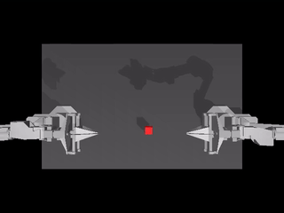
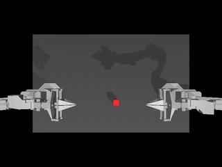
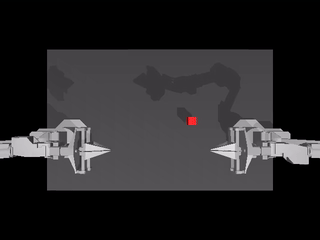
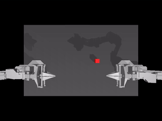
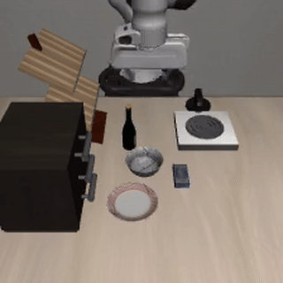
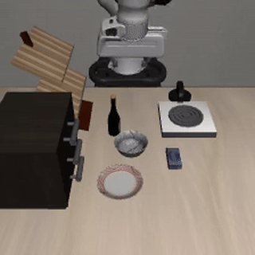

# frozen-vlm-control

Frozen vision-language features for robot control.

**Accepted at [The International Joint Symposium on Artificial Intelligence and Natural Language Processing (iSAI-NLP 2026)](https://isai-nlp2026.aiat.or.th/)**

We test whether frozen features from the robot-adapted **GR00T N1.7** endpoint help a newly trained action policy compared with **Qwen3-VL-2B**, its stock lineage origin. The experiment measures feature usefulness through closed-loop control. Behavioral and action-prediction probes examine where the resulting policies differ.

## Experiment

Both backbones are frozen and read at language layer 16. Image/text features are cached, then a token adapter and flow-matching action decoder are trained independently for each backbone with seeds **3, 4, and 5**. Head architectures, demonstration splits, and evaluation conditions are matched **within each benchmark**.

| Benchmark | Inputs and control | Head | Final checkpoint | Held-out tests per head |
|---|---|---|---|---|
| ALOHA Transfer Cube | One camera, fixed instruction, bimanual 14-DOF joint control | 14.0M trainable parameters | Epoch 250 | 200 |
| LIBERO-Goal | Agent and wrist cameras, ten familiar instruction-conditioned goals, single-arm end-effector control | 19.2M trainable parameters | Epoch 120 | 400: 40 per task |

The lineage includes Cosmos-Reason2 between Qwen and GR00T, so the endpoint comparison cannot isolate one pretraining stage. ALOHA and LIBERO differ in several ways at once; they do not isolate the effects of language, vision, camera count, or embodiment.

## Completed progression results

| Benchmark | Backbone | Seed 3 | Seed 4 | Seed 5 | Three-seed mean |
|---|---|---:|---:|---:|---:|
| ALOHA | GR00T | 49.5% | 42.5% | 64.5% | **52.2%** |
| ALOHA | Qwen | 34.5% | 18.0% | 33.5% | **28.7%** |
| LIBERO-Goal | GR00T | 89.0% | 88.8% | 91.8% | **89.8%** |
| LIBERO-Goal | Qwen | 89.8% | 91.8% | 88.0% | **89.8%** |

GR00T leads in all three ALOHA seed pairs. LIBERO has equal aggregate means and mixed seed directions. The independent training replicates are the three heads per backbone; checkpoints and rollouts from one head are not additional training replicates. Paired-start bootstrap intervals are conditional on the trained heads.

ALOHA stage analysis shows more GR00T completions among episodes reaching reward 2. On selected matched starts where both reach reward 2 and only GR00T succeeds, Qwen reaches that stage later. Two selected extended Qwen timeouts succeed beyond the original 400-step limit. LIBERO comparisons of two selected familiar goals favor Qwen on wine-to-rack and GR00T or a tie on cheese-to-bowl across the examined scenes. These diagnostics locate differences without establishing their cause inside the features.

Validation flow loss reaches its minimum early while development success often improves later; it does not reliably rank checkpoint success in these runs.

## Rollout examples

### ALOHA Transfer Cube

These videos replay archived final-test actions. Both policies start from the same reset within each row. Reset hashes and every recorded robot state and reward were verified. The two starts were selected to show opposite outcomes; they are illustrative, not a new evaluation cohort.

| Matched start (seed 3) | GR00T | Qwen |
|---|---|---|
| 10097 | **Success**<br> | **Failure**<br> |
| 10086 | **Failure**<br> | **Success**<br> |


### LIBERO-Goal

Selected seed-3 diagnostic reruns from matched starts illustrate the two focal LIBERO goals. These are examples rather than a representative sample; benchmark conclusions use the full final-test cohorts. The recorded rerun outcomes match the archived outcomes for all four clips.

| Goal and matched start | GR00T | Qwen |
|---|---|---|
| Cheese to bowl, task 6, seed 3, start 13 | **Success** | **Failure** |
| Wine to rack, task 9, seed 3, start 28 | **Failure** | **Success** |

GIF previews loop inline at 8 frames per second. ALOHA previews replay saved actions; LIBERO previews use existing diagnostic recordings. No new policy inference or training was run for the gallery.

## Status and evidence

All twelve progression heads and their final tests are complete. The [integrity audit](docs/analysis/provenance/progression_integrity_audit.json) and [seed-level summary](docs/analysis/stage1/stage1_results.json) document the records and checkpoint checks. Operational study-status files are stale; they must not be used to infer missing tests or trigger a restart. This overview does not assert that a campaign process is currently running. No new training or rollout is authorized by these documentation updates.

- [Manuscript source](manuscript/main.tex) and [PDF](manuscript/main.pdf)
- [Research objective](docs/OBJECTIVE.md), [results and evidence](docs/RESULTS.md), and [project guide](docs/README.md)
- Locked campaign configurations: [ALOHA](configs/runpod_aloha_minimum_250_success_study.json), [LIBERO](configs/libero_progression_120_success_study.json)

Earlier epoch-100 ALOHA and single-seed LIBERO comparisons are separate evidence sets. Do not pool them with progression results or use older camera-ablation and mechanistic claims as current findings.

## Repository and environments

`models/`, `data/`, and `envs/` contain runtime code; `configs/` contains experiment configurations; `scripts/` contains commands; `docs/analysis/` contains analysis tables, JSON summaries, and plots. `manuscript/` contains the paper and its figure assets. Large datasets, weights, caches, checkpoints, and raw rollout records live under ignored `asset/` paths; a clone alone does not reproduce the full experiment.

Use the existing `vla` environment for training tools, analysis, and ALOHA; use `vla_libero` for LIBERO simulation. Do not reinstall either environment merely to regenerate figures. See [scripts](scripts/README.md) for command entrypoints. Historical launch instructions are not current execution instructions.

```powershell
# Help only; no training or simulator episodes.
python scripts/train.py --help
python scripts/precompute.py --help
python scripts/evaluate.py --help
```
